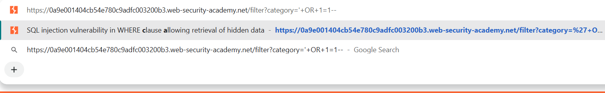
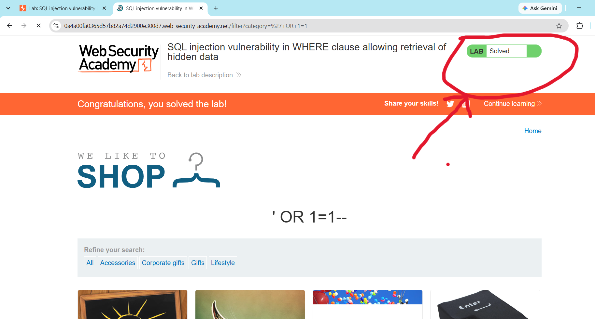

## Lab-01: SQL Injection Vulnerability In WHERE Clause Allowing Retrieval Of Hidden Data

# Lab Information
- **Platform:** PortSwigger Web Security Academy.
- **Category:** SQL Injection.
- **Difficulty:** Apprentice.
- **Status:** Solved.

# Objective
Perform SQL injection attack on the product category filter where the application displays unreleased products that are normally hidden from users.

# Vulnerability
The application builds its SQL query by directly concatenating the "category" URL parameter into the statement, without sanitization or parameterization. The backend query looks like this 
     "SELECT * FROM products WHERE category = 'Gifts'" And released =1.
     
Because user input is placed inside the query, an attacker can change its logic. The "released = 1" condition is what hides unreleased products, and it can be bypassed.

# Methodology
1) Access the lab by clicking on ACCESS THE LABbutton.
2) Navigate to Gifts page.
3) Now look at the URL, change the value of ?category=Gifts to ?category='+OR+1=1-- and click on Enter. You see the lab is solved.
# Evidence

# Root Cause
User input is concatenated directly into the SQL query as a string, so the database cannot tell the developer's query logic apart from attacker supplied input. The application also does not validate or sanitize the parameter.

# Remediation
- Use parameterized queries/prepared statements so user input is always treated as data, never as SQL query.
- Validate input against an allowlist of expected values of known category names.
- Apply least privilege to the database account used by the application.
- Avoid exposing raw database errors to users.

# Key Learnings
- A single unescaped parameter can let an attacker alter the logic of the entire query.
- Comment sequences like "--" can remove security conditions from the end of a query.
- Hidden data is not protected data. Filtering done in the SQL query alone is not an access control.
