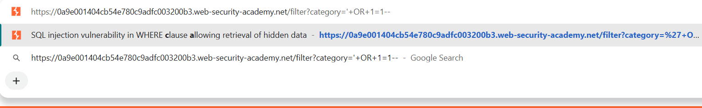
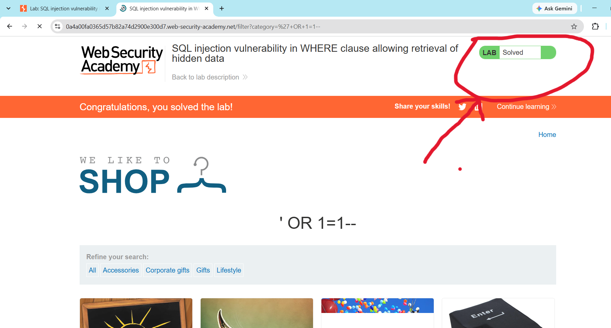

## Lab-01: SQL Injection Vulnerability In WHERE Clause Allowing Retrieval Of Hidden Data

# Lab Information
- **Platform:** PortSwigger Web Security Academy.
- **Category:** SQL Injection.
- **Difficulty:** Apprentice.
- **Status:** Solved.

# Objective
Perform SQL injection attack on the product category filter so the application displays unreleased products that are normally hidden from users.

# Vulnerability
The application builds its SQL query by directly concatenating the "category" URL parameter into the statement, without sanitization or parameterization. The backend query looks like this:
     "SELECT * FROM products WHERE category = 'Gifts'" And released =1
Because user input is placed inside the query, an attacker can change its logic. The "released = 1" condition is what hides unreleased products, and it can be bypassed.

# Methodology
1. Opened the lab and clicked a category filter (e.g: Gifts). The URL became "/filter?category=Gifts".
2. Suspected the "category" parameter was used inside a SQL query and tested it by appending a single quote ("'").
3. Injected the payload "'+OR+1=1--" into the parameter:
     "/filter?category=Gifts'+OR+1=1--"
4. The "OR 1=1" condition is always true, and "--" comments out the rest of the query, including "AND released = 1".
5. Confirmed the vulnerability: the page returned all products, including unreleased ones, and the lab was marked as solved.

# Evidence

# Root Cause
User input is concatenated directly into the SQL query as a string, so the database cannot tell the developer's query logic apart from attacker-supplied input. The application also does not validate or sanitize the parameter.

# Remediation
- Use parameterized queries (prepared statements) so user input is always treated as data, never as SQL code.
- Validate input against an allowlist of expected values (e.g: known category names).
- Apply least privilege to the database account used by the application.
- Avoid exposing raw database errors to users.

# Key Learnings
- A single unescaped parameter can let an attacker alter the logic of the entire query.
- Comment sequences like "--" can remove security conditions from the end of a query.
- Hidden data is not protected data. Filtering done in the SQL query alone is not an access control.
