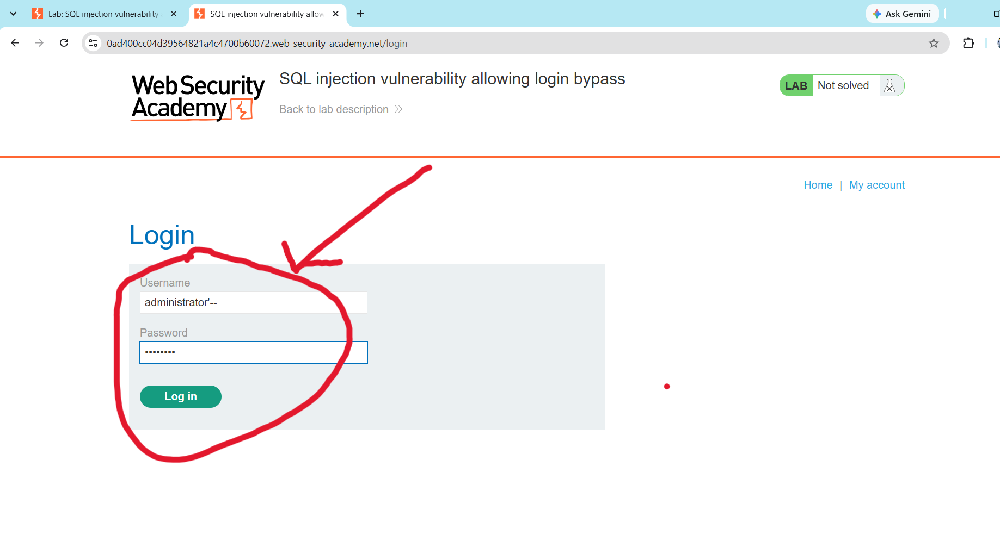
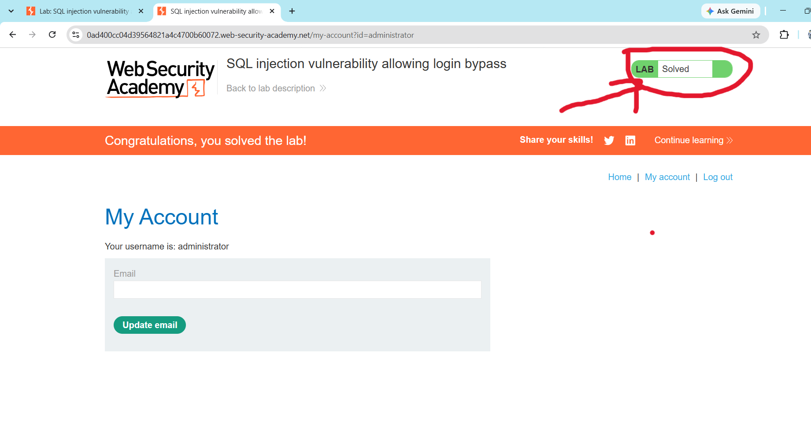

## Lab-02: SQL Injection Vulnerability Allowing Login Bypass

# Lab Information
- **Platform:** PortSwigger Web Security Academy
- **Category:** SQL Injection
- **Difficulty:** Apprentice
- **Status:** Solved

# Objective
Perform a SQL injection attack that bypasses the login form's authentication logic and lets you log in as the "administrator" user without knowing their password.

# Vulnerability
The login form builds its SQL query by directly concatenating the username and password fields into the statement, without sanitization or parameterization. The backend query looks like this 
    "SELECT * FROM users WHERE username = 'wiener' AND password = 'peter'"

Because user input is placed inside the query, an attacker can inject SQL syntax into the username field to change the query's logic and bypass the password check entirely.

# Methodology
1) Access the lab by clicking on ACCESS THE LAB button.
2) Navigate to My account.
3) In the username field enter/type administrator'-- . In password field type anything you want. I typed (anything).
4) Now click on login button. You see the lab is Solved.

# Evidence

# Root Cause
User input from the login form is concatenated directly into the SQL query as a string instead of being passed as a parameter. This lets an attacker inject SQL comment syntax to remove the password check from the query entirely.

# Remediation
- Use parameterized queries/prepared statements so user input is always treated as data, never as SQL query.
- Never build authentication logic by concatenating user input into a query.
- Apply least privilege to the database account used by the application.
- Add rate limiting and account lockout on repeated failed login attempts.
- Avoid exposing raw database errors to users.

# Key Learnings
- SQL comment sequences "--" can remove entire conditions from a query, including authentication checks.
- Authentication bypass through SQL injection does not require knowing any valid password.
- Input validation must be applied everywhere user input reaches a query, including login forms, not just search or filter parameters.
