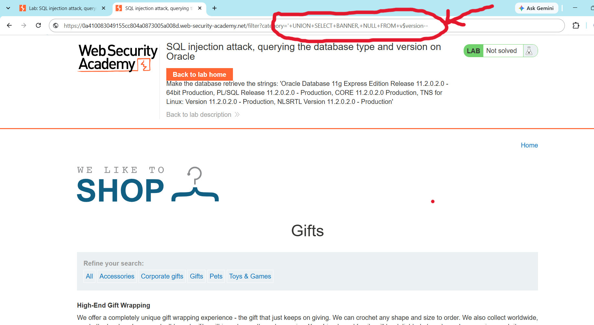
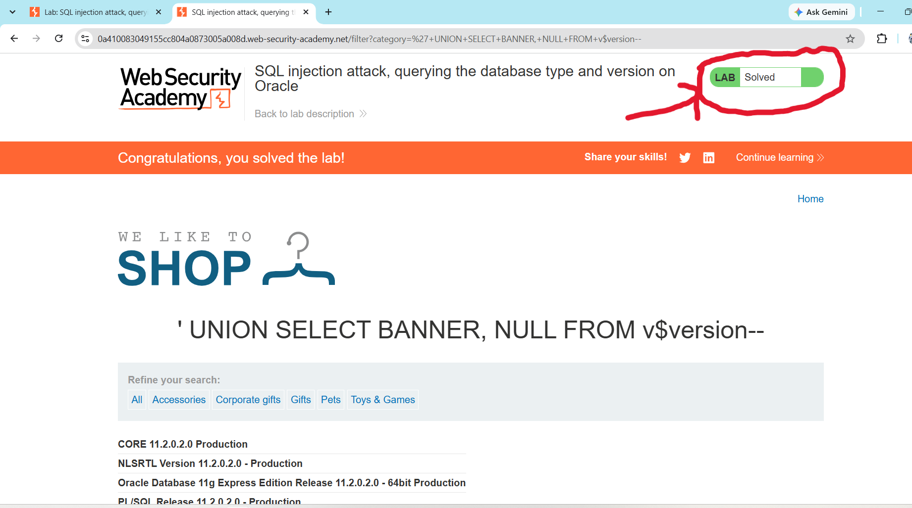

## Lab-03: SQL Injection Attack, Querying the Database Type and Version on Oracle

# Lab Information
- **Platform:** PortSwigger Web Security Academy
- **Category:** SQL Injection
- **Difficulty:** Practitioner
- **Status:** Solved

# Objective
Perform a UNION based SQL injection attack against an Oracle database to retrieve its type and version, and display this information on the page.

# Vulnerability
The applications product category filter builds its SQL query by directly concatenating the category URL parameter into the statement, without sanitization or parameterization. The backend query looks like this 
    "SELECT * FROM products WHERE category = 'Gifts' AND released = 1"

Because user input is placed inside the query, an attacker can append a "UNION SELECT" clause to retrieve data that is not normally returned, such as the database version. Oracle requires every "SELECT" to include a "FROM" clause, even when selecting from no real table, which this lab specifically tests for.

# Methodology
Lab-3: SQL Injection attack, querying the database
type and version on oracle. -Solved

Methodology:-

1) Access the lab by clicking on ACCESS THE LAB button.
2) Navigate to Gifts page. Now look at the URL.
3) To confirm the vulnerability exists on Gifts page, at the end of the URL add (') after single quote. And click on enter. You'll see an internal server error message, which confirms the vulnerability exist page. Now reset it back to normal URL.
4) To determine the number of columns exist.
- 'ORDER BY 1--  Passed
- 'ORDER BY 2--  Passed
- 'ORDER BY 3--  shows internal error message.
It means only 2 columns exist.
5) To determine the database/database types of columns.
- Use payload 'UNION SELECT 'a','a' FROM DUAL--(space), and inject it in the URL end and click on enter.
- You see that a&a at the end of the page, the payload syntax is only for Oracle db. So the database/data type is Oracle.
6) To determine the database version
- Use payload 'UNION SELECT banner, NULL from v$version-- , and inject this payload at the end of URL.
- You see the lab is solved with version of database below to the all category page names.

# Evidence

# Root Cause
User input is concatenated directly into the SQL query as a string, allowing an attacker to inject a "UNION SELECT" clause that queries internal Oracle system views instead of the intended "products" table. The application also returns query output directly to the page, to make the extracted data visible.

# Remediation
- Use parameterized queries/prepared statements so user input is always treated as data, never as SQL query.
- Apply least privilege to the database account used by the application, restrict the access to system views such as "v$version".
- Disabling the detailed database error messages in production.
- Avoid returning raw query output directly to users wherever possible.

# Key Learnings
- Oracle syntax is different from other databases, it requires a "FROM" clause on every "SELECT", and does not support "@@version", so version data must be pulled from system views like "v$version" or "v$instance".
- UNION-based attacks depend on first determining the exact column count and which columns accept string data.
- Database fingerprinting is identifying type and version, which is an early step toward further exploitation, since it tells an attacker which syntax and system tables to target next.
