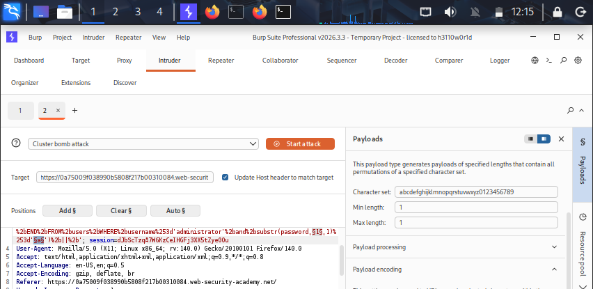
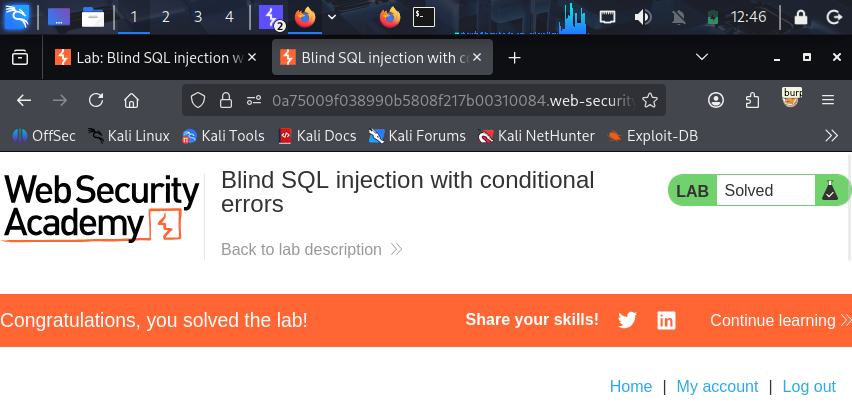

## Lab: SQL Injection Attack, Listing the Database Contents on Non-Oracle Databases

# Lab Information
- **Platform:** PortSwigger Web Security Academy
- **Category:** SQL Injection
- **Difficulty:** Practitioner
- **Status:** Solved

# Objective
Perform a UNION-based SQL injection attack to enumerate the databases own metadata table and column names, then use that information to retrieve sensitive data from a table that isn't normally exposed by the application, specifically a table holding usernames and passwords.

# Vulnerability
The application's product category filter builds its SQL query by directly concatenating the `category` URL parameter into the statement, without sanitization or parameterization. The backend query looks like this:
    SELECT * FROM products WHERE category = 'Gifts' AND released = 1
    
Because user input is placed inside the query, an attacker can use a UNION attack not only to retrieve data from known tables, but also to query the database's information schema, which lists every table and column that exists. This lets an attacker discover and extract data from tables they were never meant to access.

# Methodology
1. Opened the lab and clicked a category filter (e.g., Gifts). The URL became `/filter?category=Gifts`.
2. Determined the query returns 2 columns, both string-compatible, using `ORDER BY` and `UNION SELECT 'a','a'--`.
3. Queried the `information_schema.tables` view to list all table names in the database:
/filter?category=Gifts’+UNION+SELECT+table_name,NULL+FROM+information_schema.tables--
4. Identified a non-standard table name in the results, `users_<random>` (the lab generates a randomized suffix), which stood out from expected application tables like `products`.
5. Queried `information_schema.columns`, filtered to that table, to list its column names:
/filter?category=Gifts’+UNION+SELECT+column_name,NULL+FROM+information_schema.columns+WHERE+table_name='users_xxxx'--
6. Found two relevant columns, `username_<random>` and `password_<random>`.
7. Queried the table directly, concatenating both columns into a single output column so both values displayed within the application's 2-column layout:
/filter?category=Gifts’+UNION+SELECT+username_xxxx,password_xxxx+FROM+users_xxxx--
8. The page displayed the `administrator` username alongside their password. Used these credentials to log in as `administrator`, and the lab was marked as solved.

# Evidence

# Root Cause
User input is concatenated directly into the SQL query as a string, with no restriction on which tables or views can be queried through the injected `UNION SELECT`. This allows an attacker to read the database's own metadata (`information_schema`) and then pivot to extracting data from any table the database user can access, including tables never intended to be reachable from this part of the application.

# Remediation
- Use parameterized queries (prepared statements) so user input is always treated as data, never as SQL code.
- Apply least privilege to the database account used by the application; it should not have read access to `information_schema` or to tables unrelated to its function.
- Avoid exposing raw database query output directly to users.
- Disable detailed database error messages in production.

# Key Learnings
- `information_schema.tables` and `information_schema.columns` let an attacker enumerate the entire database structure without any prior knowledge of table or column names.
- Concatenating multiple values into a single output column (e.g., with `CONCAT()` or string concatenation operators) is a useful technique when the result set has fewer columns than the data you need to extract.
- A UNION injection point is not limited to the application's own tables; it can expose any table or view the underlying database user has permission to read, which is why database-level access control matters as much as query sanitization.
