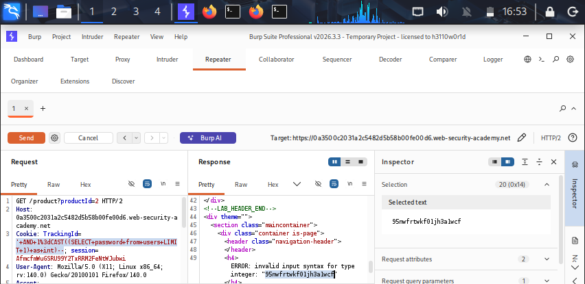

## Lab-07: SQL Injection Vulnerability Allowing Visible Error-Based Data Exfiltration

# Lab Information
- **Platform:** PortSwigger Web Security Academy
- **Category:** SQL Injection (Blind)
- **Difficulty:** Practitioner
- **Status:** Solved

# Objective
Exploit a blind SQL injection vulnerability that triggers visible database error messages in the applications response, and use these errors to directly extract data such as the administrator's password without needing conditional true/false logic.

# Vulnerability
The application uses a "TrackingId" whose value is inserted directly into a SQL query on the backend, without sanitization or parameterization. The application does not display query results directly, but when a database error occurs, the resulting error message is returned in the response. This means an attacker can craft a payload that deliberately causes the database to throw an error containing the data they want to extract, embedded inside the error message itself, removing the need to ask repeated true/false questions.

# Methodology
1. Opened the lab, connected Burp, and viewed the first product details page. Captured its request product id=0 and sent it to Repeater.
2. Tested the TrackingId cookie for injection by appending a single quote ('). This returned an internal server error that revealed the exact backend query in the response:
   SELECT * FROM tracking WHERE id='<trackingid>' confirming the query and the injection point.
3. Tested '-- to close the string and comment out the rest of the query → returned 200 OK, with no error, confirming the injected syntax was valid.
4. Used CAST() to force a type-mismatch error, to confirm the administrator user exists:
   'AND 1=CAST((SELECT password FROM users WHERE username='administrator') AS int)--  → returned 200 OK, confirming the query was valid.
5. Leaked the administrator's username by removing the TrackingId value and injecting:
   'AND 1=CAST((SELECT username FROM users LIMIT 1) AS int)--  → returned a 500 error with the username revealed in the error message.
6. Leaked the administrator's password using the same technique:
  'AND 1=CAST((SELECT password FROM users LIMIT 1) AS int)--  → returned a 500 error with the password revealed in the error message.
7. Logged in as administrator using the leaked password, and the lab was marked solved.
# Evidence

# Root Cause
User input from the "TrackingId" cookie is concatenated directly into a SQL query, and the application returns raw database error messages to the user instead of a generic error page. Combined with a type conversion function that embeds query results into its error text, this allows an attacker to exfiltrate arbitrary data in a single request, rather than needing a slow blind extraction technique.

# Remediation
- Use parameterized queries/prepared statements so user input is always treated as data, never as SQL query.
- Never return raw database error messages to the client, show a generic error page and log details server side only.
- Apply least privileges to the database account used by the application.
- Avoid using user controlled input including cookies in SQL queries without validation.

# Key Learnings
- Visible error based SQL injection is far faster to exploit than blind conditional techniques, since data can be read directly from a single error message instead of inferred bit-by-bit.
- Type conversion functions "CAST", "CONVERT", "EXTRACTVALUE" can be abused to force a query result into an error message when they fail, leaking the underlying data.
- Verbose database error messages returned to end users are a serious information disclosure risk and should always be disabled in production.
- Cookies and other non-obvious input points must be treated as untrusted and validated the same as URL parameters and form fields.
