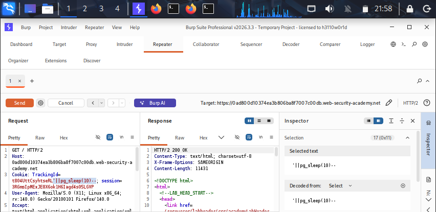
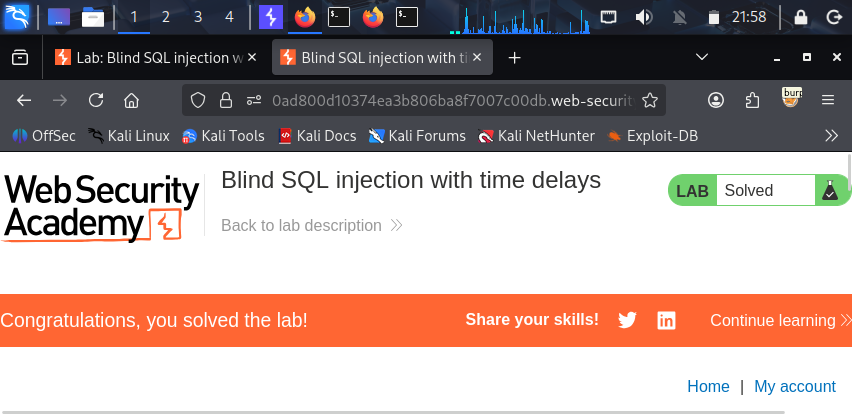

## Lab: Blind SQL Injection with Time Delays

# Lab Information
- **Platform:** PortSwigger Web Security Academy
- **Category:** SQL Injection (Blind)
- **Difficulty:** Practitioner
- **Status:** Solved

# Objective
Detect a blind SQL injection vulnerability where the applications response gives no visible difference between true and false conditions, and no visible database errors, by using time delays as the only observable signal.

# Vulnerability
The application uses a "TrackingId" whose value is inserted directly into a SQL query on the backend, without sanitization or parameterization. The applications response is identical regardless of whether an injected condition is true or false, and no error messages are returned, so there is no direct way to observe the result of an injected query. However, an attacker can inject a conditional time delay function such as "pg_sleep()", and measure how long the response takes to determine whether the injected condition was true.

# Methodology
1) Access the lab by clicking on ACCESS THE LAB button. And connect the burp to your browser.
2) In browser click on Home link text, you will see the "GET /" url is captured under HTTP history of burp, right click on it and send it to repeater.
3) Time delay payload
- Use payload '||pg_sleep(10)--, inject it at the end of trackingid's value and click on send button,after 10 seconds you will get the 200 OK response. And
you see the lab is solved.

# Evidence

# Root Cause
User input from the "TrackingId" cookie is concatenated directly into a SQL query, and the application gives no visible indication, no error message, and no difference in response content, of whether an injected condition is true or false. This forces an attacker to rely on response time instead of errors or content differences, but the injection is still fully exploitable because the database executes whatever conditional logic is injected.

# Remediation
- Use parameterized queries/prepared statements so user input is always treated as data, never as SQL query.
- Apply least privileges to the database account used by the application, and disable or restrict access to functions like "pg_sleep()" where not required.
- Avoid using user-controlled input including cookies in SQL queries without validation.
- Implement rate limiting, request timeouts, and anomaly detection to make time-based blind attacks slower and easier to detect.

# Key Learnings
- When an application shows no visible errors or content differences, response time can still serve as a reliable true/false oracle for blind SQL injection.
- Time delay functions differ by database engine, "pg_sleep()" for PostgreSQL, "WAITFOR DELAY" for Microsoft SQL Server, "SLEEP()" for MySQL, and "DBMS_PIPE.RECEIVE_MESSAGE()" for Oracle.
- Time based blind injection is the slowest extraction technique since each bit of information requires a full delay, so it is typically used only when error based or boolean based techniques are unavailable.
- Confirming an unconditional delay first "pg_sleep(10)" with no condition, is a useful way to validate the injection point before building conditional payloads.
